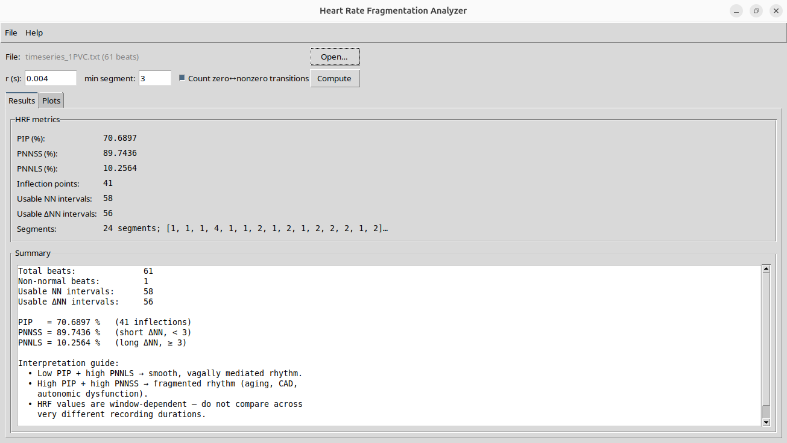
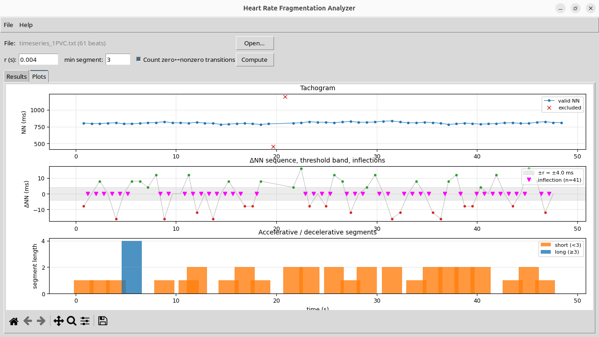

<div align="center">

# Heart Rate Fragmentation Analyzer

**A Python / Tkinter port of the PhysioNet HRF reference software,  
with interactive visualization for clinical and research use.**

[](https://www.python.org/)
[](#license)
[](https://doi.org/10.13026/0mzj-gn98)
[](https://doi.org/10.3389/fphys.2017.00255)
[](#requirements)
[](#history)
[](#history)

<br>

[](https://github.com/attilaasghari/heart-rate-fragmentation/archive/refs/heads/main.zip)
[](https://github.com/attilaasghari/heart-rate-fragmentation/releases/latest)

<br>

Created by [**Asal Karimi**](https://asal.archtek.ir) · [**Attila Asghari**](https://attila.archtek.ir) · [**Archtek**](https://archtek.ir)

*Developed in 2025 · Published in 2026*

</div>

---

## Table of Contents

- [Overview](#overview)
- [History](#history)
- [Why Heart Rate Fragmentation?](#why-heart-rate-fragmentation)
- [The Three Metrics](#the-three-metrics)
- [Screenshots](#screenshots)
- [Requirements](#requirements)
- [Installation](#installation)
- [Usage — GUI](#usage--gui)
- [Usage — Python API](#usage--python-api)
- [Input Format](#input-format)
- [Parameters](#parameters)
- [Validation Against the PhysioNet Reference](#validation-against-the-physionet-reference)
- [Implementation Notes & Known Ambiguities](#implementation-notes--known-ambiguities)
- [Performance & Recording-Length Caveats](#performance--recording-length-caveats)
- [References](#references)
- [Credits](#credits)
- [License](#license)
- [Disclaimer](#disclaimer)

---

## Overview

This project is a faithful, tested re-implementation of the official
[PhysioNet Heart Rate Fragmentation software (v1.0.0)](https://physionet.org/content/heart-rate-fragmentation-code/1.0.0/)
in pure Python 3, with a Tkinter desktop GUI and embedded Matplotlib
diagnostic plots.

The original PhysioNet release is written in AWK and provides only
numbers on stdout. This port preserves the algorithm exactly — including
beat filtering, thresholding, and segment classification — while
adding:

- a cross-platform GUI (Windows, macOS, Linux);
- interactive diagnostic plots that make the algorithm auditable;
- a clean, importable Python API (`compute_hrf`, `load_input_file`)
  for scripting, batch processing, and notebooks;
- export of results to TSV.

The method itself is described in Costa, Davis & Goldberger (2017),
*Frontiers in Physiology* **8**:255.

---

## History

The HRF Analyzer was **developed in 2025** by Asal Karimi, Attila
Asghari, and Archtek, and was **first published in 2026** as an
open-source release on GitHub under the MIT License.

| | |
|---|---|
| **Development** | 2025 |
| **Public release** | 2026 |
| **Current version** | v1.0.0 |
| **Repository** | [attilaasghari/heart-rate-fragmentation](https://github.com/attilaasghari/heart-rate-fragmentation) |

The version history of this project is:

- **v1.0.0 (2026)** — First public release. Python/Tkinter port of the
  PhysioNet AWK reference, with GUI, three diagnostic plots,
  interactive parameter tuning, TSV export, and a documented
  validation protocol against the three PhysioNet test files.

---

## Why Heart Rate Fragmentation?

Traditional heart rate variability (HRV) metrics such as rMSSD and HF
power assume that short-term beat-to-beat variability reflects vagal
tone. This produces the well-documented **HRV paradox**: high
short-term variability can arise from healthy respiratory sinus
arrhythmia *or* from pathological fragmentation of the rhythm. The two
look identical to HRV metrics, and high-risk individuals are routinely
misclassified as low-risk.

HRF resolves the paradox by quantifying the **temporal structure** of
variability rather than its amplitude. Instead of asking *how much* the
heart rate changes, HRF asks *how often and in what shape* the
acceleration reverses. Healthy rhythms are dominated by long, smooth,
respiratory-driven accelerative and decelerative runs; ageing and
cardiovascular disease produce an excess of short, non-respiratory
reversals.

Validated associations include ageing, coronary artery disease, major
adverse cardiovascular events (MACE), atrial fibrillation, cognitive
decline, white-matter hyperintensities, coronary calcification, and
surgical risk scores — several of which are **independent of
traditional HRV**.

---

## The Three Metrics

| Metric | Full name | Definition |
|--------|-----------|------------|
| **PIP** | Percentage of Inflection Points | Number of reversals in HR acceleration divided by the total number of usable NN intervals (×100). |
| **PNNSS** | Percentage of ΔNN in Short Segments | ΔNN intervals belonging to accelerative/decelerative runs shorter than `min_segment` beats, as a percentage of all ΔNN intervals in such runs. |
| **PNNLS** | Percentage of ΔNN in Long Segments | ΔNN intervals belonging to runs of length ≥ `min_segment`, as a percentage of all ΔNN intervals in such runs. |

An **inflection point** is a change in sign of consecutive ΔNN
differences (`ΔNN(i+1)` and `ΔNN(i)`) after applying a noise threshold
`r`. A run is a maximal contiguous stretch of same-signed ΔNN.

Interpretation:

- **Low PIP + high PNNLS** → smooth, vagally mediated rhythm (healthy).
- **High PIP + high PNNSS** → fragmented rhythm (ageing, CAD,
  autonomic dysfunction).

---

## Screenshots

> Replace these placeholders with real screenshots after first run.

| Main window | Plots tab |
|:-:|:-:|
|  |  |

The Plots tab shows three synchronized panels:

1. **Tachogram** — NN intervals vs. time, with excluded beats highlighted.
2. **ΔNN sequence** — the exact quantity being thresholded, with the
   ±`r` band drawn and every detected inflection marked.
3. **Segment bars** — length of each accelerative / decelerative run,
   colored by short (orange) / long (blue) classification.

---

## Requirements

- **Python 3.8 or newer**
- **NumPy** ≥ 1.20
- **Matplotlib** ≥ 3.5
- **Tkinter** — bundled with Python on Windows and macOS. On Debian/Ubuntu: `sudo apt install python3-tk`.

That's it — no compiled dependencies, no MNE, no wfdb, no SciPy.

A `requirements.txt` is provided:

```text
numpy>=1.20
matplotlib>=3.5
```

---

## Installation

### Option 1 — Download ZIP (quickest, no git)

1. Click **[⬇ Download Source ZIP](https://github.com/attilaasghari/heart-rate-fragmentation/archive/refs/heads/main.zip)** above.
2. Extract the archive.
3. Install dependencies:

   ```bash
   cd heart-rate-fragmentation-main
   python3 -m pip install -r requirements.txt
   ```

4. Run the app:

   ```bash
   python3 main.py
   ```

### Option 2 — Clone

```bash
git clone https://github.com/attilaasghari/heart-rate-fragmentation.git
cd heart-rate-fragmentation
python3 -m pip install -r requirements.txt
python3 main.py
```

### Option 3 — Grab a release

Visit the [latest release](https://github.com/attilaasghari/heart-rate-fragmentation/releases/latest)
and download either `main.py` (single file) or the full source
archive.

---

## Usage — GUI

1. **Open** a file via *File → Open…* (or `Ctrl+O`).
   The file must be a two-column ASCII table (see [Input Format](#input-format)).
2. Adjust parameters if needed:
   - **`r` (s)** — noise threshold, default `0.004` s
     (= 1 sample at 250 Hz).
   - **min segment** — minimum run length for "long", default `3`.
   - **Count zero↔nonzero transitions** — default *on*; matches the
     PhysioNet description. Turn off for a strict sign-reversal rule.
3. Press **Compute**. The *Results* tab shows PIP / PNNSS / PNNLS and
   counts; the *Plots* tab draws the three diagnostic panels.
4. **Export** the results to a TSV via *File → Export…*.

The plots are fully interactive (pan / zoom / save) courtesy of the
embedded `NavigationToolbar2Tk`.

---

## Usage — Python API

The core algorithm is a pure function, independent of Tkinter, so it
can be used headlessly in scripts and notebooks:

```python
from main import load_input_file, compute_hrf

times, labels = load_input_file("Test_1.txt")
result = compute_hrf(times, labels, r=0.004, min_segment=3)

print(f"PIP   = {result['PIP']:.3f} %")
print(f"PNNSS = {result['PNNSS']:.3f} %")
print(f"PNNLS = {result['PNNLS']:.3f} %")
print(f"Inflections: {result['n_inflections']} / {result['num_nn']} NN")
```

The returned dictionary also contains the full intermediate arrays
(`nn`, `dnn`, `dnn_thr`, `signs`, `infl_mask`, `seg_info`, …) for
custom downstream analysis.

---

## Input Format

Two whitespace- or comma-separated columns, one row per beat:

| Column 1 | Column 2 |
|:---------|:---------|
| R-peak time (seconds) | Beat label |

**Beat labels:**

| Label | Meaning |
|:-----:|:--------|
| `1` | Normal sinus beat |
| `2` | Premature atrial complex (PAC) |
| `3` | Premature ventricular complex (PVC) |
| any other | Treated as non-normal, excluded |

Example:

```text
0.812   1
1.611   1
2.412   1
3.198   1
3.987   3
4.812   1
5.611   1
...
```

**Only intervals between two normal beats are used.** Any NN interval
whose boundary touches a non-normal beat, and any ΔNN interval computed
across such a gap, is discarded. This mirrors the AWK reference
behavior and prevents PVC compensatory pauses from generating spurious
inflections.

Comments (`#`-prefixed lines) and blank lines are skipped.

---

## Parameters

| Name | Default | Unit | Meaning |
|------|---------|------|---------|
| `r` | `0.004` | s | Noise threshold. `|ΔNN| < r` is treated as zero. Use `0.004` for 250 Hz, `0.001` for 1000 Hz, `0.002` for 500 Hz. |
| `min_segment` | `3` | ΔNN count | Runs of length < `min_segment` are "short", ≥ `min_segment` are "long". |
| `count_zero_transitions` | `True` | bool | If True, a transition between zero and nonzero ΔNN counts as an inflection. |

---

## Validation Against the PhysioNet Reference

The Python port **must reproduce the AWK reference output on the
three PhysioNet test files** before it can be trusted on real data.
Follow these steps.

### Step 1 — Download the reference implementation and test files

From the [PhysioNet HRF page](https://physionet.org/content/heart-rate-fragmentation-code/1.0.0/):

```bash
mkdir physionet_ref && cd physionet_ref
curl -O https://physionet.org/files/heart-rate-fragmentation-code/1.0.0/HRF.awk
curl -O https://physionet.org/files/heart-rate-fragmentation-code/1.0.0/Test_1.txt
curl -O https://physionet.org/files/heart-rate-fragmentation-code/1.0.0/Test_2.txt
curl -O https://physionet.org/files/heart-rate-fragmentation-code/1.0.0/Test_3.txt
```

The three test files correspond to:

| File | Contents |
|------|----------|
| `Test_1.txt` | One PVC |
| `Test_2.txt` | One PVC + one outlier |
| `Test_3.txt` | One PVC + two outliers |

(If the filenames differ on the live PhysioNet page, substitute the
actual names — the three scenarios are what matter.)

### Step 2 — Run the AWK reference

```bash
for f in Test_*.txt; do
    awk -f HRF.awk "$f" > "${f%.txt}.awk.out"
done
```

Note the three metric values printed by the reference for each file.

### Step 3 — Run the Python port headlessly

```bash
python3 - <<'PY'
from main import load_input_file, compute_hrf
for i in (1, 2, 3):
    t, l = load_input_file(f"Test_{i}.txt")
    r = compute_hrf(t, l, r=0.004, min_segment=3)
    print(f"Test_{i}  PIP={r['PIP']:.6f}  "
          f"PNNSS={r['PNNSS']:.6f}  PNNLS={r['PNNLS']:.6f}  "
          f"infl={r['n_inflections']}  NN={r['num_nn']}")
PY
```

### Step 4 — Compare

Fill in this table (tolerance: numerically identical, or within
`1e-3` on percentages if the reference rounds):

| File | Metric | AWK reference | Python port | Match? |
|------|--------|--------------:|------------:|:------:|
| `Test_1` | PIP   |               |             |        |
| `Test_1` | PNNSS |               |             |        |
| `Test_1` | PNNLS |               |             |        |
| `Test_2` | PIP   |               |             |        |
| `Test_2` | PNNSS |               |             |        |
| `Test_2` | PNNLS |               |             |        |
| `Test_3` | PIP   |               |             |        |
| `Test_3` | PNNSS |               |             |        |
| `Test_3` | PNNLS |               |             |        |

If any row mismatches, see the next section — the discrepancy will
almost certainly come from one of the four documented ambiguities in
the AWK source.

### Step 5 — Regression

Once the initial run matches, keep the three test files in a
`tests/` directory and add them to a `pytest` suite:

```python
# tests/test_reference.py
import pytest
from main import load_input_file, compute_hrf

EXPECTED = {
    "Test_1": {"PIP": ..., "PNNSS": ..., "PNNLS": ...},   # fill from AWK
    "Test_2": {"PIP": ..., "PNNSS": ..., "PNNLS": ...},
    "Test_3": {"PIP": ..., "PNNSS": ..., "PNNLS": ...},
}

@pytest.mark.parametrize("name,expected", EXPECTED.items())
def test_matches_reference(name, expected):
    t, l = load_input_file(f"tests/{name}.txt")
    r = compute_hrf(t, l)
    for k, v in expected.items():
        assert r[k] == pytest.approx(v, abs=1e-3), (name, k)
```

---

## Implementation Notes & Known Ambiguities

The PhysioNet documentation contains four points where the prose and
the AWK code can be read differently. This port makes the choices
below; if validation fails against the reference, adjust in this
order.

1. **Inflection definition.** The prose says
   *"ΔNN(i+1) × ΔNN(i) ≥ 0 and ΔNN(i+1) ≠ ΔNN(i)"*, which is
   internally inconsistent if read literally (a genuine sign reversal
   gives a *negative* product). This port interprets it as a
   **sign change** of `s ∈ {−1, 0, +1}` after thresholding `r`.
   `count_zero_transitions=True` makes a zero↔nonzero transition count
   as an inflection (matching the "one is zero" clause);
   `False` requires both sides nonzero.

2. **Zero handling in segments.** In this port, a ΔNN interval
   thresholded to zero is **neutral** — it neither belongs to a run
   nor breaks one. So `+, 0, +, +` is a single run of length 3. If the
   AWK source instead breaks runs on zeros, `PNNSS`/`PNNLS` will
   differ. Test this first if you see a mismatch.

3. **Outlier marking.** The documented input format only defines
   labels `1/2/3`. This port treats *any* label other than `1` as
   excluded. If the PhysioNet test files mark outliers with a
   different convention (say, label `9`), the filtering logic in
   `compute_hrf` is a single line — adjust `valid_nn` accordingly.

4. **Gaps across excluded beats.** ΔNN is only computed between two
   *consecutive* valid NN intervals. Comparisons are not made across a
   gap left by an excluded beat. This is the natural reading of
   "adjacent intervals whose length cannot be reliably determined",
   but confirm against the reference.

The GUI's toggles and the `r` field expose items 1 and 2 directly, so
you can flip behavior interactively while comparing against the
reference output.

---

## Performance & Recording-Length Caveats

- **Runtime.** Vectorized NumPy inner loops; a 24-hour Holter trace
  (~100 000 beats) computes in under 100 ms on any modern laptop.
  Plotting is the slow part — the GUI renders ~100 000 points fine
  with the Agg backend but you may want to downsample for display
  on very long recordings.
- **Window length.** **HRF values are not constant over time.** Like
  every dynamical measure they depend on the analysis window. There is
  no universally agreed minimum window; the same caveats apply as in
  HRV analysis. Do not compare PIP values from a 5-minute strip with
  those from a 24-hour Holter without acknowledging the difference.
- **Artifacts.** A missed beat, a mislabeled PVC, or a motion artifact
  will often inflate PIP. Always inspect the *Tachogram* panel — the
  point of having it there is to catch QC problems before you trust
  the number.

---

## References

**Method**

> Costa MD, Davis RB, Goldberger AL. *Heart rate fragmentation: a new
> approach to the analysis of cardiac interbeat interval dynamics.*
> Frontiers in Physiology. 2017;8:255.
> [doi:10.3389/fphys.2017.00255](https://doi.org/10.3389/fphys.2017.00255)

**Reference software**

> Costa M. *Software for computing Heart Rate Fragmentation* (v1.0.0).
> PhysioNet. 2024.
> [doi:10.13026/0mzj-gn98](https://doi.org/10.13026/0mzj-gn98)

**Selected applications** (as summarized on PhysioNet)

- Ageing and coronary artery disease (Costa et al., 2017)
- MACE and incident atrial fibrillation
- Cognitive decline and MRI markers of small-vessel disease
- Coronary artery calcification
- Pre- vs. post-sleep ΔHRF
- Blood-pressure fragmentation in surgical risk prediction

---

## Credits

This Python port was designed and developed by:

| | Name | Website |
|:-:|:-----|:--------|
| 👩‍💻 | **Asal Karimi** | [asal.archtek.ir](https://asal.archtek.ir) |
| 👨‍💻 | **Attila Asghari** | [attila.archtek.ir](https://attila.archtek.ir) |
| 🏢 | **Archtek** | [archtek.ir](https://archtek.ir) |

**Development:** 2025 · **First public release:** 2026

The underlying method and the reference AWK implementation are by
**Madalena D. Costa**, **Roger B. Davis**, and **Ary L. Goldberger**
(Beth Israel Deaconess Medical Center / Harvard Medical School) and
are distributed under an open-access license on PhysioNet. This port
is an independent re-implementation and is not affiliated with or
endorsed by the original authors.

---

## License

This Python port is released under the **MIT License**. See
[`LICENSE`](LICENSE) for details.

The PhysioNet reference software and the original method remain under
their respective licenses; consult the [PhysioNet page](https://physionet.org/content/heart-rate-fragmentation-code/1.0.0/)
for terms of use of the reference implementation and any associated
data.

---

## Disclaimer

> **This software is a research tool. It is not a medical device and
> is not intended for diagnosis, treatment, or clinical decision-making.**
> All results must be validated against the PhysioNet reference test
> files and independently confirmed before any use in research
> publications, and must never be used to guide patient care without
> appropriate regulatory clearance and clinical validation.